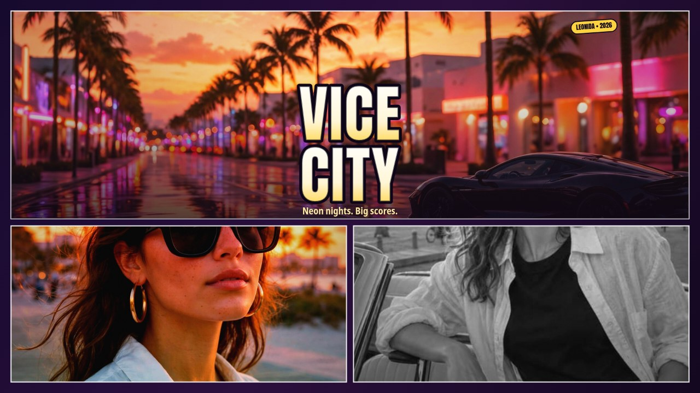

# Vice Cover Studio

[](https://make.fun/bounty/gta6-cover-art-01?utm_source=github&utm_medium=readme&utm_campaign=gta6-cover-art-01)
[](https://make.fun/bounty/gta6-cover-art-01/leaderboard?utm_source=github&utm_medium=readme&utm_campaign=gta6-cover-art-01)
[](https://make.fun/bounty/gta6-cover-art-01?utm_source=github&utm_medium=readme&utm_campaign=gta6-cover-art-01)

Turn your photos and a caption into a multi-panel sunset cover — the
poster look, made offline in your browser. Built for
[Make GTA 6 Cover Art](https://make.fun/c/gta6-cover-art-01) on make.fun.



## What it does

- **Four poster layouts** — Sunset Grid (hero + two), Neon Triptych (three
  vertical), Vice Split (hero + two stacked), Postcard (one full-bleed).
- **Any photo, any panel** — upload your own photos or use the four
  AI-made samples. One photo can fill every panel, or each panel can have
  its own.
- **Crop per panel** — drag the photo inside the preview to frame it,
  scroll or use the slider to zoom. Pan is clamped so the photo always
  covers its panel.
- **A grade per panel** — Sunset, Neon, Noir or Clean. Each grade is a
  canvas colour treatment (saturation, gradient-map overlay, vignette)
  plus a touch of film grain.
- **Big condensed lettering** — a two-line title in Anton with a black
  outline and a white-to-gold gradient, a tagline, and a tilted sticker
  badge. All editable, live.
- **One-step export** — PNG in 1080×1080, 1080×1350 or 1920×1080, or all
  three at once.

## Run it

No build step, no network, no account. Your photos never leave the
browser.

```sh
node serve.ts
# open http://localhost:8080
```

Pick a layout, tap a photo and a panel, type your caption, hit
**Download PNG**.

Deterministic scenes for screenshots and headless checks:

- `?shot=cover&layout=sunset-grid&size=1920x1080&photo=vice-street`
  — the cover alone, filling the window.
- `?shot=editor` — the editor with a sample loaded.
- `?selftest=1` — renders every layout at every export size and writes
  PASS/FAIL into the page.

## Files

- `app/index.html`, `app/style.css` — the editor page.
- `app/src/cover.js` — the cover engine: layouts, grades, lettering.
- `app/src/main.js` — the editor wiring.
- `app/src/shots.js` — `?shot=` scenes and `?selftest=1`.
- `app/fonts/Anton-Regular.ttf` — Anton, SIL Open Font License 1.1
  (see `app/fonts/OFL.txt`).
- `app/samples/` — four sample photos: two made with an image model for
  this entry, two from the make.fun kit. No real person is pictured.

## Notes

Unofficial fan-made tool. Not affiliated with Rockstar Games. No
Rockstar logo, artwork or font is used. MIT licensed — see `LICENSE`.
